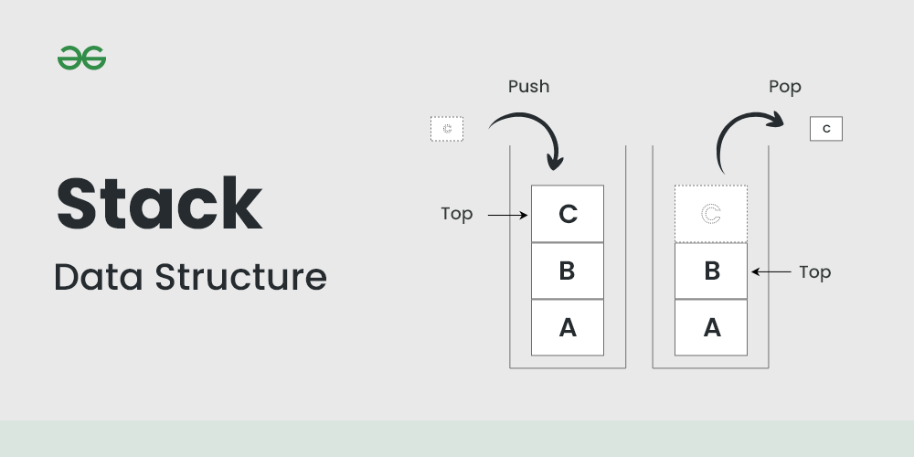
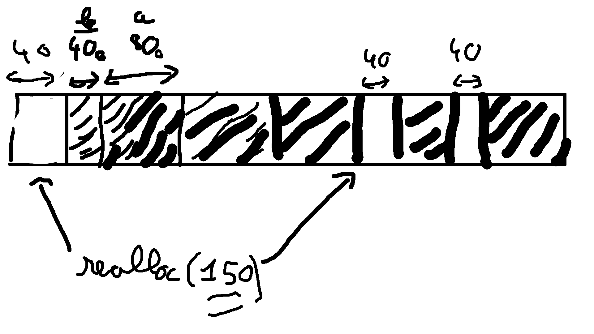

# Types de mémoires
- Volatile: perd les données quand on enlève l'alimentation
- Non-volatile: ne perd pas les données quand on enlève l'alimentation


## Flash memory

EEPROM: electrically erasable programmable read-only memory


# Structures de données


## pile(fr)/stack(en)
La pile est la structure de données implémentée de base, c'est ce qui stoque les variables locales dans les fonctions. La pile change de taille au cours de l'exécution du programme pour acommoder les variables de cette fonction ainsi que les appels de fonctions. Un appel récursif non controlé d'une fonction peut ammener à un "stack overflow" c'est à dire pile qui grandit plus que la taille qui lui est permise.


## tas(fr)/heap(en)
Le tas est là pour allouer des gros morçeaux de données, on va avoir tendance à l'éviter en systèmes embarqués du fait de la fragmentation des données et non déterminisme en terme de temps d'exécution (Si la mémoire est très fragmentée, celà peut prendre très longtemps).

Pour changer la taille de la pile ou du tas dans le microcontroleur, il faut editer le fichier linker:

```linker-script
_Min_Heap_Size = 0x200;	/* required amount of heap  */
_Min_Stack_Size = 0x400;	/* required amount of stack */
```
