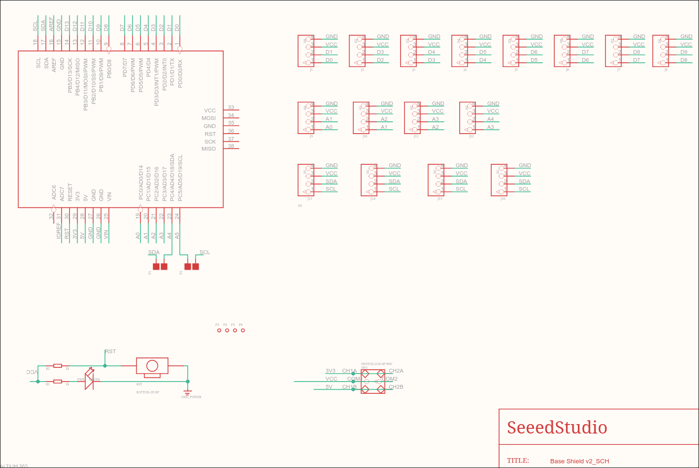
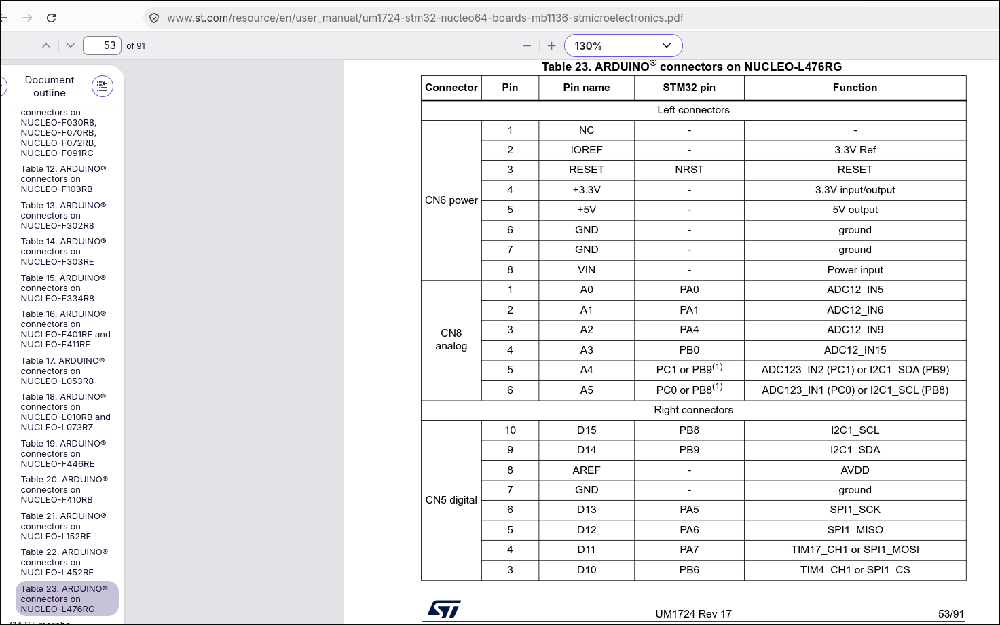
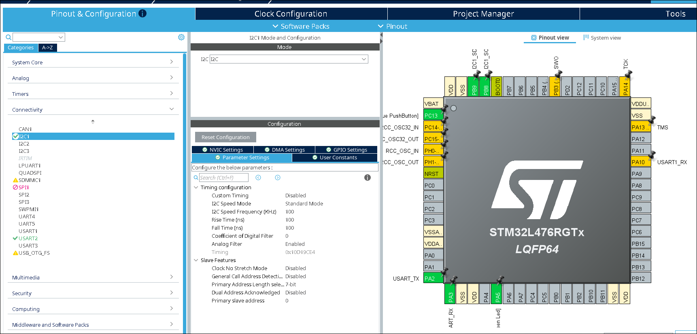

Pour apporter nos modifications au programme il faut tout d'abord le tourner sur notre carte.
Pour le faire ont doit connecter les capteurs à notre carte d'expention et connecter celle-ci sur notre carte Nucleo.
Pour le faire on prettera attention aux schémas des différentes cartes, et à l'aide de STM32CubeMX on configure les périphériques sur les sorties correspondantes.

[schematic viewer carte expention](https://wiki.seeedstudio.com/Base_Shield_V2/#schematic-online-viewer)
[schematic viewer carte gps](https://wiki.seeedstudio.com/Grove-GPS-Air530/)

