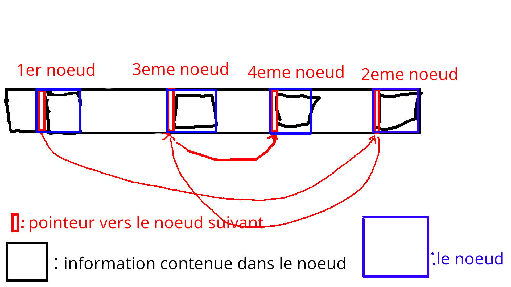
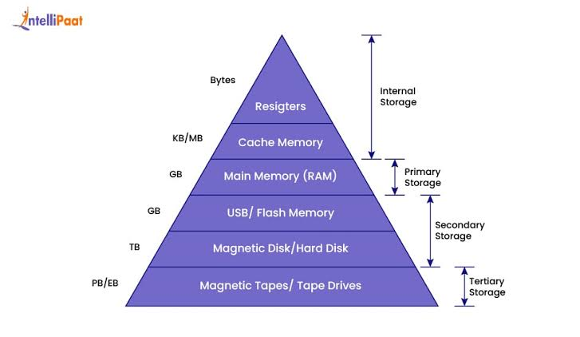
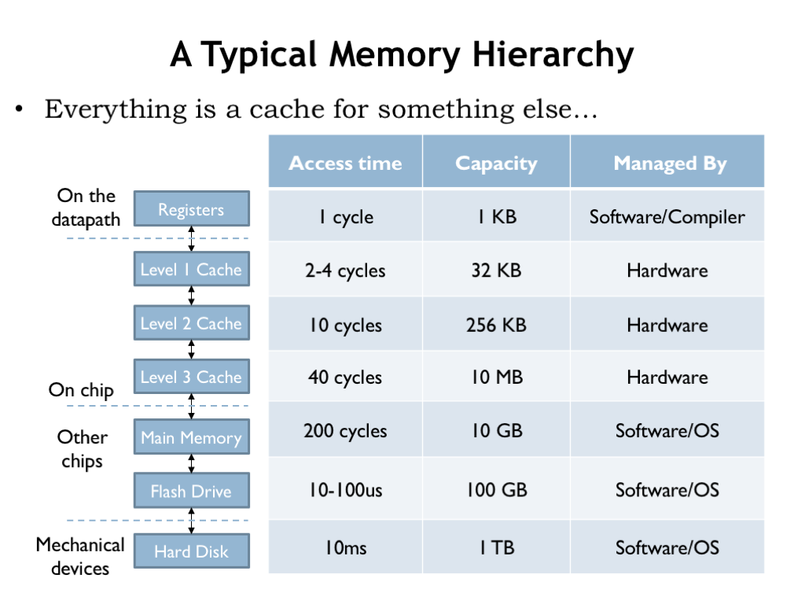

# Les structures
Les structures permettent de regrouper des information ensemble, elles stoqués souvent de façon contigue (ou presque).

Pour déclarer une structure `maison` on utilise la syntaxe suivante:
```c
struct maison {
	int prix;
	int age;
	float hauteur;
	char nom[20];
};
```

Dans celle-ci se trouvent les **champs** prix, age, hauteur et nom.

Pour initialiser une structure on utilise la syntaxe suivante:

```c
	struct maison ma_maison = {.prix = 200000, .age = 10, .hauteur = 42.1};
```

Exemple de programme sur les structures
```c
#include <stdio.h>

struct maison {
	int prix;
	int age;
	float hauteur;
	char nom[20];
};

void imprimer_valeurs_maison(struct maison m) {
	printf("ma maison a %d ans\n", m.age);
	printf("ma maison coûte %d euros\n", m.prix);
	printf("ma maison a %f m d'hauteur\n", m.hauteur);
}

int main(void) {
	struct maison ma_maison = {.prix = 200000, .age = 10, .hauteur = 42.1};

	imprimer_valeurs_maison(ma_maison);
}
```

# Liste chainée
Une liste chainée est une succession de noeuds (node en anglais). Ils sont liés entre eux par un pointeur qui pointe vers le noeud suivant.



# Notion de contiguité en mémoire et rapidité d'accès
Des programmes rapides auront souvent tendance à préférer les stockages d'information de façon contigue (proche dans l'espace), celà augmentera la possibilité d'un **"cache hit"**.
C'est à dire que des éléments utilisés prochainement dans un programme soient déjà présents dans la mémoire cache (SRAM), évitant ainsi la nécesité d'aller les chercher dans mémoire principale plus lente (DRAM)





[vidéo explicative du fonctionnement derière les systèmes de fichier à base de FAT (File Allocation Table)](https://www.youtube.com/watch?v=V2Gxqv3bJCk)

[Autre vidéo sur les systèmes de fichiers en général](https://www.youtube.com/watch?v=KN8YgJnShPM)
