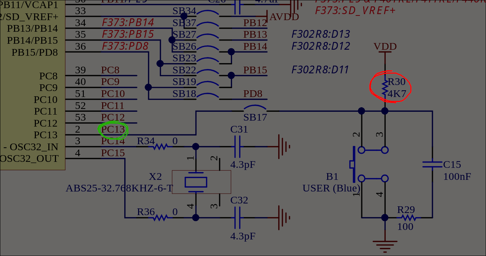
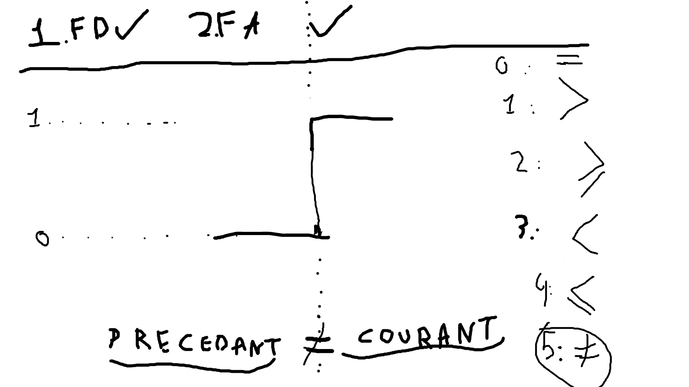
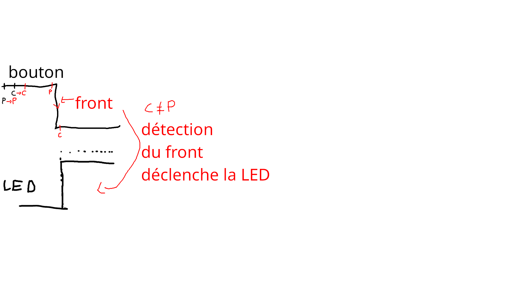

## Branchement du bouton sur la carte Nucleo
Le bouton utilisateur B1 (bleu) est branché sur PC13 (vert).
Il présente une résistence de PULL-UP (rouge) nomée R30 sur le schéma de câblage.
Cette sésistence nous indique que la broche PC13 est à l'état HAUT quand aucun appui n'est réalisé.
Quand on appuira sur le bouton, cette broche sera tirée vers le BAS.



## Comment on détecte un front?


## Actualisation de l'état précédent
Il faut actualiser l'état précédent du bouton pour que celui vienne juste après la nouvelle mesure

```c
if(courant == precedent) {
...
}
precedent = courant // mise à jour de l'état après la vérification
```




